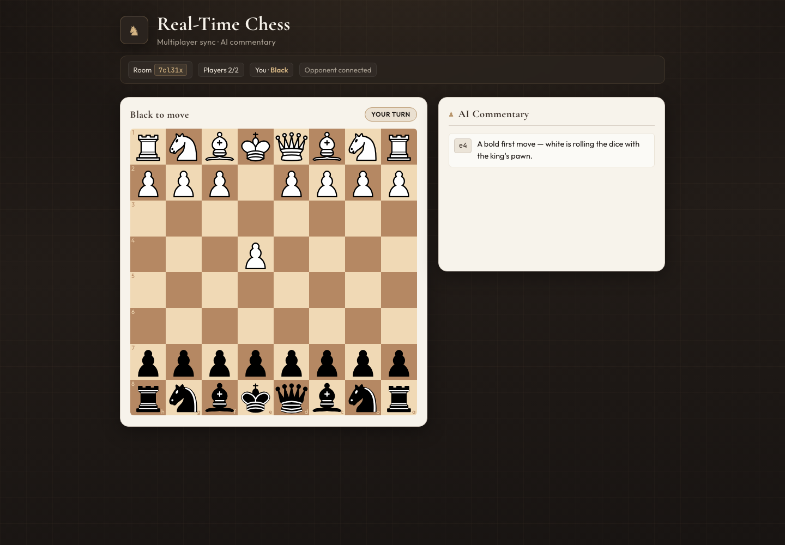

# Real-Time Chess

Two-player chess built around a server-authoritative Socket.IO protocol, persisted room state, optimistic UI, and commentary that never blocks the move path.



The case study is on [orlandoascanio.com/work/real-time-chess](https://www.orlandoascanio.com/work/real-time-chess).

## The real problem was shared state

A chess interface can validate a move in the browser and still be wrong.

Two players can act against stale boards. A modified client can ignore turn rules. An external commentary service can take seconds while the other player is waiting to see the move. A reconnect creates a new socket identity even if the human is the same.

I built Real-Time Chess as that two-player game, with a small protocol and an explicit authority model.

## Constraints

- **The client is untrusted.** Browser validation improves feedback, but cannot decide which move is legal for both players.
- **Moves must feel immediate.** Commentary and storage work cannot make the board wait on an external model.
- **Both players need one event history.** Room membership is the fan-out boundary for moves and commentary.
- **Local setup should stay simple.** The server can run against PostgreSQL or an in-memory store with the same application interface.
- **Failure needs a visible state.** Rejected moves roll back, commentary has a loading state, and model failure falls back to local rules.

## Architecture

```text
React client A ─┐                         ┌─ PostgreSQL
                ├─ Socket.IO ─ GameManager ┤  or memory Map
React client B ─┘       │                 └─ chess.js
                       │
                       └─ commentary context
                          ├─ OpenRouter
                          └─ rule-based fallback
```

The Socket.IO handler stays thin. It receives a command, asks the game manager to apply it, then emits the result.

The domain path is:

```text
Room membership → player color → current turn → chess.js legality → persistence → broadcast
```

An invalid request never becomes shared state.

[Architecture notes](docs/architecture.md) cover the move lifecycle and the trade-offs. [Socket.IO protocol](docs/socket-protocol.md) lists the payloads.

## Events

The system has three client commands:

- `create-room`
- `join-room`
- `move`

And five server outcomes:

- `room-updated`
- `move`
- `commentary`
- `invalid-move`
- `error`

Each event has one job. `room-updated` sends a complete snapshot after room membership changes. `move` is the fast live path. `commentary` is a later side effect tied to the accepted move by Standard Algebraic Notation (SAN).

| Direction | Event | Purpose |
| --- | --- | --- |
| Client → server | `create-room` | Create a room and assign its creator White |
| Client → server | `join-room` | Join an existing room and take the remaining seat |
| Client → server | `move` | Request a move |
| Server → room | `room-updated` | Send the full room snapshot after create or join |
| Server → room | `move` | Broadcast an accepted move and its sender |
| Server → room | `commentary` | Broadcast commentary for the accepted move, by SAN |
| Server → client | `invalid-move` | Reject an illegal move or a move on the wrong turn |
| Server → client | `error` | Report a malformed request, a room failure, or a storage error |

## Server authority with an optimistic client

The browser uses its own `chess.js` instance so a legal drag updates immediately. It then emits the move request.

The server does not trust that local result. It reloads the room, checks that the socket owns a seat, verifies the player's color against the current turn, and asks its own `chess.js` instance to apply the move.

If the server rejects the request, the client restores the last synchronized FEN position. The server's check keeps both boards on the same position.

The current protocol identifies the sender so the optimistic client can ignore its own broadcast. A production version would go further and add a client move ID plus an explicit acknowledgment.

## Slow work stays off the move path

An accepted move is saved and broadcast before commentary generation starts.

```text
save move → emit move → generate commentary → save commentary → emit commentary
```

The commentary pipeline receives bounded chess context rather than a raw prompt: SAN, FEN, turn, game status, captured piece, recent moves, and recent commentary. It then uses OpenRouter when configured or a local rule-based generator when no key exists or the provider fails.

The server caps output at 160 characters and the UI shows a pending entry while it waits. The board never depends on the model call completing.

## Persistence

The room store exposes the same operations for PostgreSQL and an in-memory `Map`.

PostgreSQL saves:

- player records;
- FEN;
- verbose move history;
- derived game status;
- commentary history.

Memory mode makes the project easy to run and gives the verification script an isolated test environment. With PostgreSQL, that same room snapshot survives process memory loss while a match is active.

Socket IDs are the player identities, and the server deletes a room when its last socket disconnects, so there is no account and no saved game archive.

## Quick start

### Requirements

- Node.js 18 or newer
- npm
- PostgreSQL only if you want durable room snapshots

### 1. Install dependencies

```bash
git clone https://github.com/orlandoascanio/Chess-app-Socketio.git
cd Chess-app-Socketio/chess-app
npm install --prefix server
npm install --prefix client
```

### 2. Configure local development

```bash
cp server/.env.example server/.env
cp client/.env.example client/.env
```

The committed server template starts in memory mode, so PostgreSQL is not required for a first run.

### 3. Start both processes

Terminal one:

```bash
cd chess-app/server
npm run dev
```

Terminal two:

```bash
cd chess-app/client
npm run dev
```

Open [http://localhost:5173](http://localhost:5173). Create a room, open a second tab, and join with the displayed room ID.

For PostgreSQL, OpenRouter, CORS, and troubleshooting, follow [How to run the project locally](docs/local-development.md).

## Verification

The repository includes a two-client Socket.IO verifier. Install both packages first, then run:

```bash
cd chess-app/server
node scripts/verify-socket-flow.mjs
```

The script starts an isolated server and checks:

- room creation and joining;
- player count and initial commentary state;
- accepted move payload shape;
- SAN propagation;
- sender identity;
- move delivery before commentary;
- commentary shape and the 160-character cap;
- wrong-turn rejection.

The client also has ESLint and a production Vite build:

```bash
cd chess-app/client
npm run lint
npm run build
```

The manual browser pass used two tabs, joined both players, played `e4`, confirmed Black received the move and shared commentary, and found no console errors.

See [Testing and verification](docs/testing.md) for the full checklist.

## What I would change for production

Replace socket IDs as player identity with authenticated player IDs and signed seat tokens. A reconnect should replace the transport and keep the same player.

The current store uses read-modify-write snapshots. I would add a room version, optimistic concurrency checks, and a per-room command queue before horizontal scaling.

Multiple Node.js instances would need a shared Socket.IO adapter and the same room commands on every process.

Move requests should carry a client sequence or idempotency key. The server should acknowledge the accepted command so retries and latency are measurable.

The next test layer would cover malformed payloads, duplicate rooms, full rooms, concurrent moves, PostgreSQL integration, optimistic rollback, and provider timeouts.

Those limits are also in [Architecture: trade-offs and next steps](docs/architecture.md#trade-offs-and-next-steps).

## Project structure

```text
.
├── docs/
│   ├── architecture.md
│   ├── local-development.md
│   ├── socket-protocol.md
│   └── testing.md
└── chess-app/
    ├── client/                 # React, Vite, react-chessboard
    └── server/
        ├── db/                 # PostgreSQL and memory-backed room store
        ├── models/             # Game, Player, and Room domain objects
        ├── services/           # Commentary context and generators
        ├── socket.js           # Real-time protocol handlers
        └── server.js           # Express and Socket.IO entry point
```

## Related notes

- [A WebSocket connection is not a real-time architecture](https://www.orlandoascanio.com/notes/websocket-connection-is-not-realtime-architecture)
- [Server authority without a sluggish interface](https://www.orlandoascanio.com/notes/server-authority-without-sluggish-ui)
- [Keep slow work off the real-time path](https://www.orlandoascanio.com/notes/keep-slow-work-off-realtime-path)

## Contributing

Small, focused pull requests are welcome. Before opening one, run the client lint and build, then the socket verifier:

```bash
cd chess-app/client
npm run lint
npm run build

cd ../server
node scripts/verify-socket-flow.mjs
```

Do not commit `.env` files, database credentials, OpenRouter keys, or generated logs.

## License

[MIT](LICENSE)
